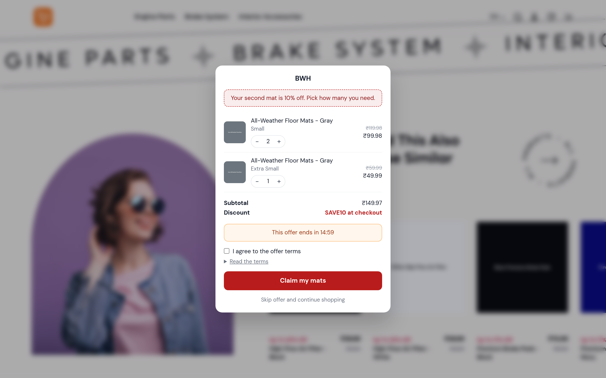
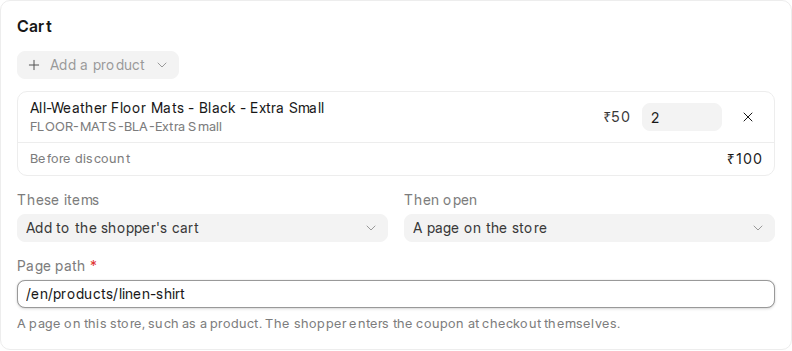
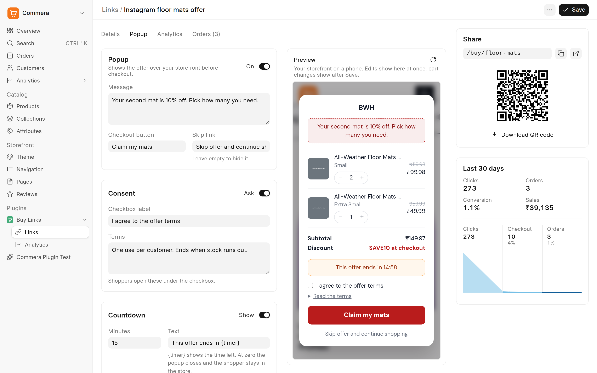
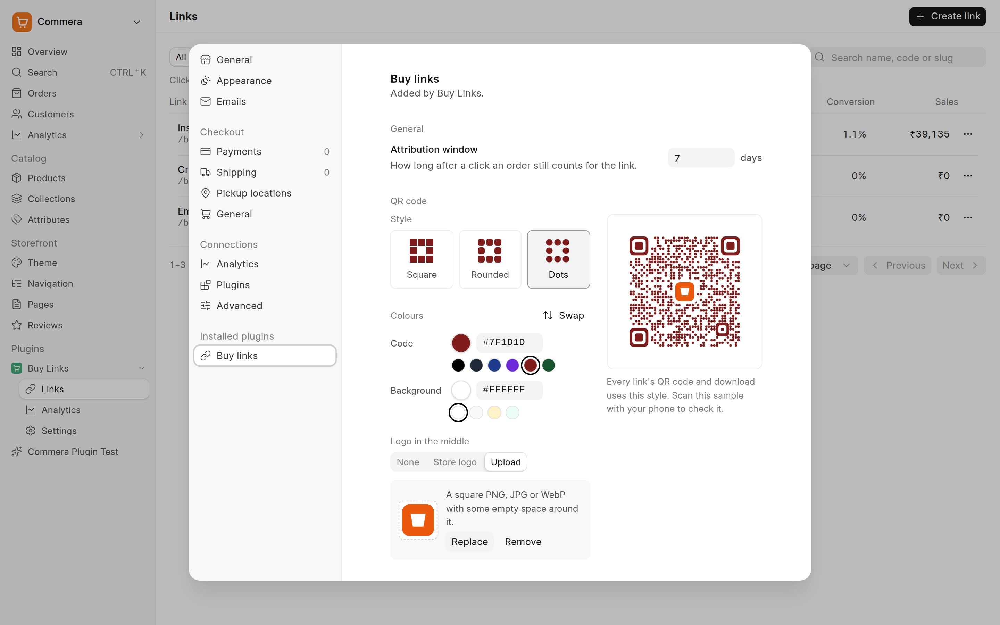

## Buy Links

A [Commera](https://github.com/bwhtech/commera) plugin for shareable links that fill the shopper's cart, apply a coupon, fill checkout fields and open checkout. Share one in an ad, an email, an SMS or a chat reply, and see which link made the money.


### What a link does

When a shopper opens `/buy/<code>` (or `/buy/<slug>`), the plugin:

1. Checks that the link is active, inside its schedule and under its usage limit. If not, the shopper sees a short message in the store theme.
2. Counts the click and remembers the link in a cookie for the attribution window.
3. Redirects (302) to Commera's cart permalink. Commera fills the cart, then opens checkout, the cart or a page on the store. Checkout applies the coupon and fills empty fields.


#### Popup before checkout

A link can show its offer in a popup over the storefront first, as a short stop on the way to checkout: a message, the cart with quantity controls, the coupon, an optional countdown and an optional consent checkbox, then **Checkout** or **Skip**. The popup uses the store's theme colours.



The popup needs **Run on the storefront** turned on for Buy Links under **Settings > Plugins** in `/commera`. Commera then loads the plugin's storefront script. While it is off, a link with a popup goes straight to checkout.

A visitor's own `checkout[...]` and `utm_...` parameters override the link's values, so one link can serve many shoppers:

```text
https://store.example.com/buy/spring-sale?checkout[email]=asha@example.com&utm_content=email-2
```

### Features

| Area | What you get |
| --- | --- |
| Cart | Products and quantities. The link replaces the shopper's cart or adds to it, then opens checkout, the cart or a page on the store |
| Discount | An ERPNext Coupon Code, applied at checkout |
| Customer prefill | Email, name and address for empty checkout fields |
| Attribution | UTM values for the store analytics. The order keeps the link when the shopper opened it within the attribution window and the cart still holds one of its items |
| Order tags | Added to every order placed through the link |
| Limits | Usage limit, once per customer, start and end. With a coupon, checkout removes the coupon when a limit is hit, tells the shopper why, and shows the full-price total. At the usage limit the link moves to Draft |
| Popup | An optional stop over the storefront before checkout: message, cart with quantities, coupon, countdown, consent, Checkout and Skip |
| Share | Short URL, copy, open and a QR code in the store's style (Square, Rounded or Dots, two colours and an optional logo in the middle, set in **Settings → Buy links**), downloadable as SVG, PNG or PDF |
| Analytics | Clicks, orders, conversion and sales for today, 7, 30 or 90 days, with the change against the previous period, a daily trend, a funnel from click to checkout to order, and the top links by sales |

### In the dashboard

**Buy Links → Links** lists every link with its last 30 days. **Create link** asks for a name and products, then opens the link as a draft.


A link has three tabs: **Details** (setup), **Analytics** and **Orders**. The side panel stays on every tab: the share box with its QR code, and the last 30 days with a funnel from click to checkout to order.


Under the cart, **These items** replaces the shopper's cart or adds to it, and **Then open** goes to checkout, the cart or a page on the store. The coupon reaches checkout from the cart. On another page, the shopper enters it at checkout.



The **Popup** tab sets the message, the button labels, consent and the countdown, with a live preview of your storefront at phone width. Edits show in the preview before you save.




**Buy Links → Analytics** shows every link together.


An order placed through a link shows a **Buy link** card with the link, the coupon and the UTM values. A product has **Create buy link** in **More actions**.


**Buy Links → Settings** in the sidebar opens the plugin's tab in the Commera Settings dialog. It sets the attribution window and the QR code: style, code and background colours, and a logo in the middle (none, the store logo, or an uploaded PNG, JPG or WebP). A live preview shows each change, drawn by the same code as the downloads, and each change saves on its own. A warning shows when the colours are too close for phones to read. With a logo, the code uses more error correction, so phones still read it.



### Install

Buy Links needs a Commera version with `plugin.config.ts` sidebar actions ([#253](https://github.com/bwhtech/commera/pull/253)) and the storefront switch ([#244](https://github.com/bwhtech/commera/pull/244)).

```bash
bench get-app https://github.com/bwhtech/commera_buy_links
bench --site <site> install-app commera_buy_links
bench build --app commera
```

`bench build --app commera` builds the Commera dashboard and every installed plugin, this one included.

### Develop

Run `yarn dev` in `apps/commera/dashboard` and open `/commera` on port 8080. A saved `.vue` file in `commera/` updates in place. See [Commera's plugin docs](https://docs.bwh.tech/commera/build-a-plugin/overview).

```bash
bench --site <site> run-tests --app commera_buy_links
```

### Known gaps

[GAPS.md](GAPS.md) lists what the plugin cannot do yet, with the Commera issue for each platform gap. [notes.md](notes.md) records what the reference app, Checkout Links, does.

### License

MIT
