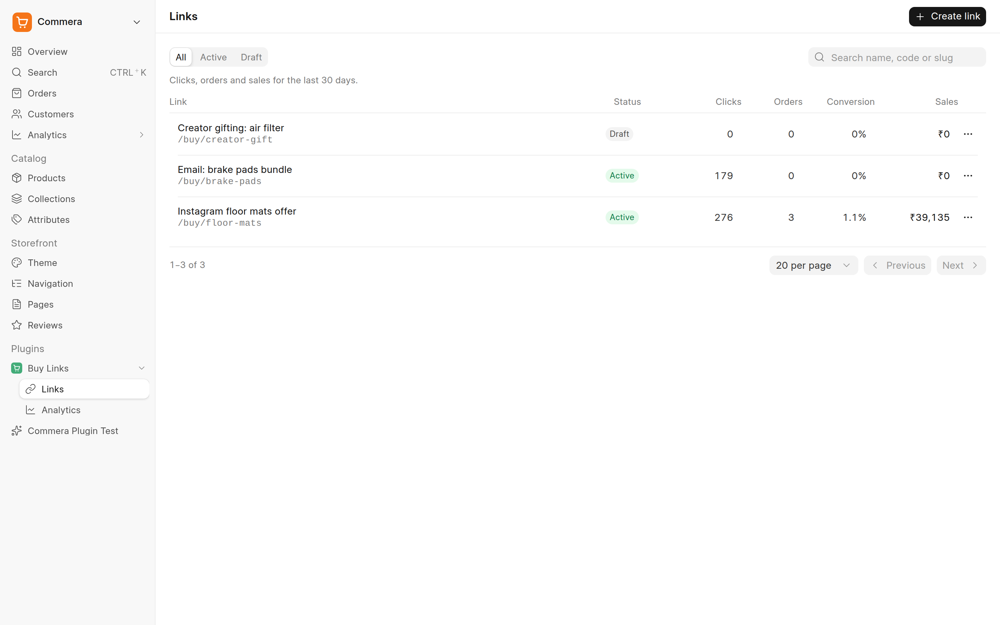
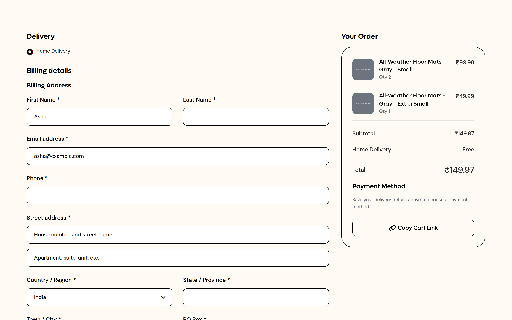
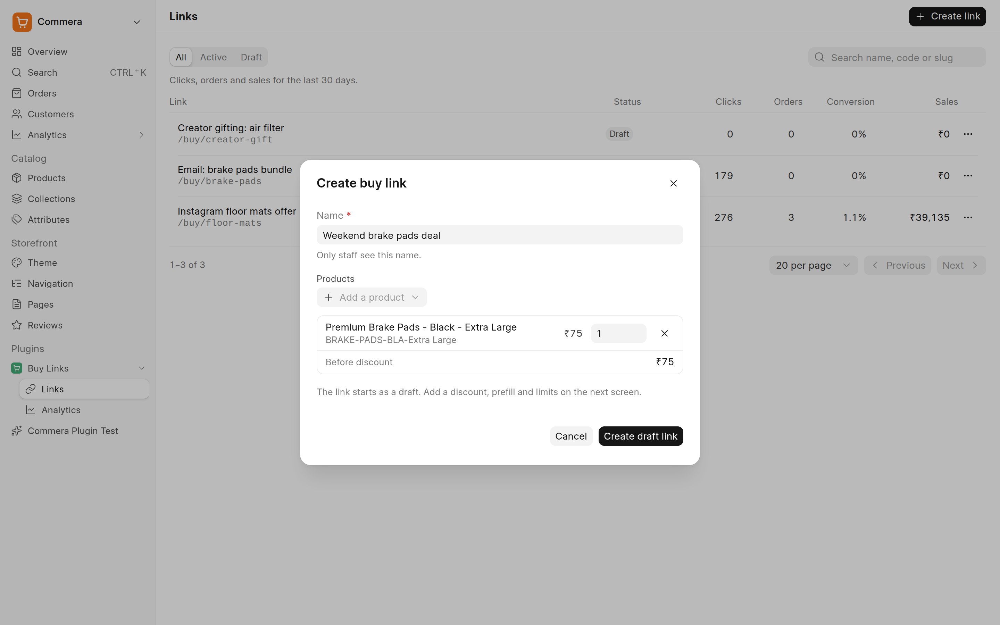
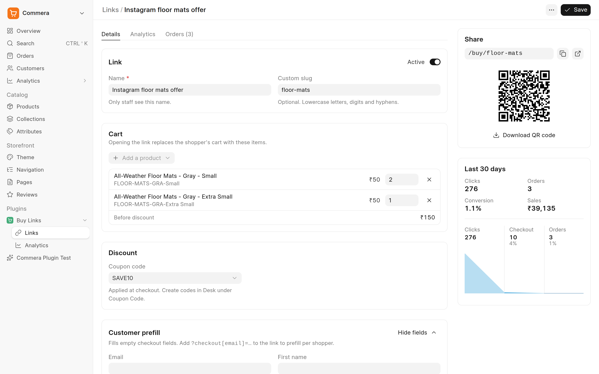
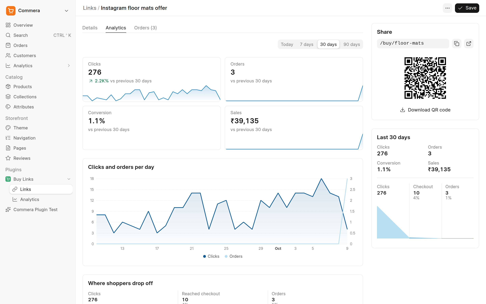
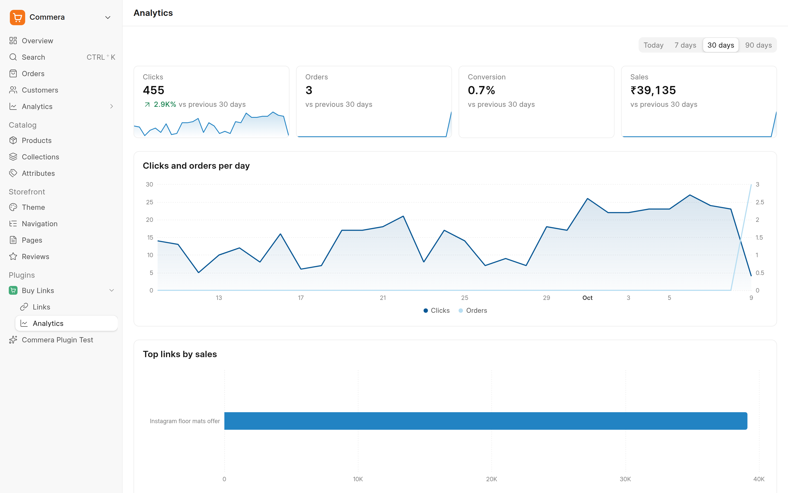
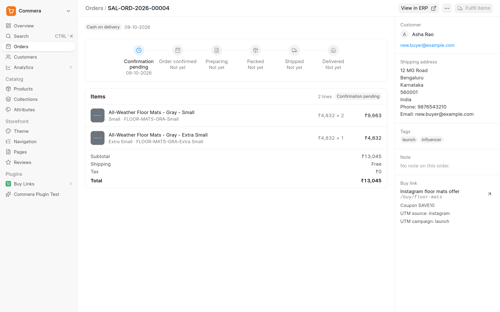

## Buy Links

A [Commera](https://github.com/bwhtech/commera) plugin for shareable links that fill the shopper's cart, apply a coupon, fill checkout fields and open checkout. Share one in an ad, an email, an SMS or a chat reply, and see which link made the money.



### What a link does

When a shopper opens `/buy/<code>` (or `/buy/<slug>`), the plugin:

1. Checks that the link is active, inside its schedule and under its usage limit. If not, the shopper sees a short message in the store theme.
2. Counts the click and remembers the link in a cookie for the attribution window.
3. Redirects (302) to Commera's cart permalink. Commera fills the cart, applies the coupon, fills empty checkout fields and opens checkout.



A visitor's own `checkout[...]` and `utm_...` parameters override the link's values, so one link can serve many shoppers:

```text
https://store.example.com/buy/spring-sale?checkout[email]=asha@example.com&utm_content=email-2
```

### Features

| Area | What you get |
| --- | --- |
| Cart | Products and quantities. Opening the link replaces the shopper's cart |
| Discount | An ERPNext Coupon Code, applied at checkout |
| Customer prefill | Email, name and address for empty checkout fields |
| Attribution | UTM values for the store analytics. The order keeps the link when the shopper opened it within the attribution window and the cart still holds one of its items |
| Order tags | Added to every order placed through the link |
| Limits | Usage limit, once per customer, start and end. With a coupon, checkout refuses the coupon when a limit is hit, and the shopper can still buy at full price. At the usage limit the link moves to Draft |
| Share | Short URL, copy, open and a QR code (SVG) |
| Analytics | Clicks, orders, conversion and sales for today, 7, 30 or 90 days, with the change against the previous period, a daily trend, a funnel from click to checkout to order, and the top links by sales |

### In the dashboard

**Buy Links → Links** lists every link with its last 30 days. **Create link** asks for a name and products, then opens the link as a draft.



A link has three tabs: **Details** (setup), **Analytics** and **Orders**. The side panel stays on every tab: the share box with its QR code, and the last 30 days with a funnel from click to checkout to order.





**Buy Links → Analytics** shows every link together.



An order placed through a link shows a **Buy link** card with the link, the coupon and the UTM values. A product has **Create buy link** in **More actions**. **Settings → Buy links** sets the attribution window.



### Install

```bash
bench get-app https://github.com/bwhtech/commera_buy_links
bench --site <site> install-app commera_buy_links
bench build --app commera
```

`bench build --app commera` builds the Commera dashboard and every installed plugin, this one included.

### Develop

Run `yarn dev` in `apps/commera/dashboard` and open `/commera` on port 8080. A saved `.vue` file in `commera/` updates in place. See [Commera's plugin docs](https://docs.bwh.tech/commera/build-a-plugin/overview).

```bash
bench --site <site> run-tests --app commera_buy_links
```

### Known gaps

[GAPS.md](GAPS.md) lists what the plugin cannot do yet and what Commera needs for it.

### License

MIT
